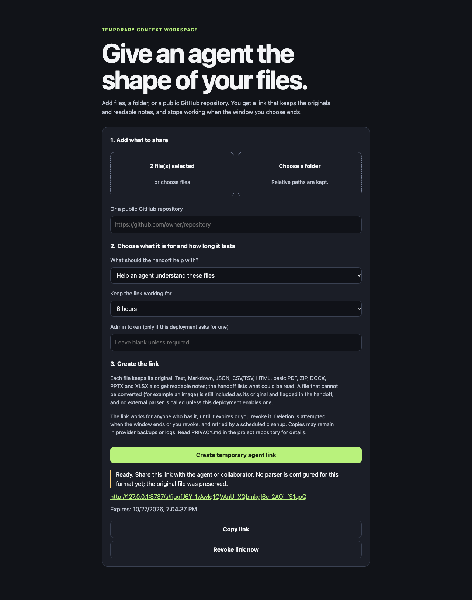

# Agent File Optimizer

**Hand files to an agent, then let them expire.**

[](https://github.com/rmichaelthomas/agent-file-optimizer/actions/workflows/ci.yml)
[](LICENSE)
[](https://workers.cloudflare.com/)

[Project site](https://rmichaelthomas.github.io/agent-file-optimizer/) · [Deploy your own copy](https://deploy.workers.cloudflare.com/?url=https://github.com/rmichaelthomas/agent-file-optimizer) · [Try it locally](#try-it-in-two-minutes) · [Limits](#capabilities)



You have a folder of mixed files: a PDF, a spreadsheet, some notes, a zip. You want an AI agent, or a colleague, to read it. Explaining each file, converting some of them, and remembering which copy is current is the tedious part.

Agent File Optimizer does that preparation once. You add the files (or a public GitHub repository) and get **one link**. Whoever opens it finds your originals, a short note saying what is there and what to read first, and readable text for the formats it understands. When the window you chose ends (1, 6, or 12 hours), the link stops working and the stored content is deleted.

It is open source and self-hosted. There is no hosted service to sign up for, and this repository does not run one. It runs on your own Cloudflare account, or on your computer with no account at all.

## Why people reach for it

- **An agent needs to read a folder**, and you do not want to write conversion commands or explain each file.
- **A collaborator needs something for an afternoon**, and you do not want it sitting in a shared drive afterwards.
- **You want the agent to start from the originals** plus an orientation note, not from whatever it can scrape.
- **You want a clock on it.** The link ends on its own, and you can end it sooner.

## Try it in two minutes

No account, nothing leaves your machine:

```sh
git clone https://github.com/rmichaelthomas/agent-file-optimizer.git
cd agent-file-optimizer
npm install
npm run dev
```

Open the address it prints, drop in a file, and press **Create temporary agent link**. The data lives in `.wrangler/` on your computer.

Ready to run your own copy for real? Use the button, which needs a Cloudflare account and no terminal, or see [Get started](#get-started) for the one-command route.

[](https://deploy.workers.cloudflare.com/?url=https://github.com/rmichaelthomas/agent-file-optimizer)

## What an agent receives

Open the link and the first thing it gets is `handoff.md`, a plain-language orientation. This is real output for a two-file workspace:

```markdown
# Agent File Optimizer handoff

This is a temporary workspace prepared for agent use. Its content is deleted when the window ends or the link is revoked.
It was created for **agent-understanding** and expires at **2026-10-28T03:49:33.742Z** (UTC).

## Start here

- Read `manifest.json` for file-level provenance, hashes, parser status, and warnings.
- Read `content.md` for the compact human-readable projection.
- Read `content.jsonl` for row- or record-oriented ingestion.
- Read `tree.txt` to understand the workspace layout.
- Use `original/<path>` when the projection is incomplete or fidelity matters.

Files: **2**
```

A person who opens the same link in a browser sees the same note as a readable page. An agent, or `curl`, receives the Markdown above. The workspace contains:

| File | What it is |
| --- | --- |
| `handoff.md` | What the workspace is for, when it expires, and what to read first. |
| `manifest.json` | Each file with its hash, the parser used, a confidence level, and any warnings. |
| `tree.txt` | The folder layout. |
| `content.md` | Readable text from the files that could be converted. |
| `content.jsonl` | Structured records for JSON, CSV/TSV, and similar files. |
| `original/<path>` | Every file exactly as you added it. |

The manifest is honest about what it could not do. A file it cannot read stays as an original and is flagged, rather than being silently dropped or guessed at. See a [sample manifest](docs/examples/manifest.example.json).

## How it compares

| If you would otherwise... | What is different here |
| --- | --- |
| Zip the folder and share a drive link | The agent gets an orientation note and a manifest, not a bundle to unpack. The link ends by itself. |
| Paste files into a chat | Originals stay intact, paths are kept, and the same link works for several agents or sessions within the window. |
| Use a tool that flattens a repository into one prompt | This takes mixed folders, not only repositories, and keeps the originals beside the readable text. It does not do private repositories. |
| Use a hosted file-sharing service | You run it, so the files sit in an account you control. The cost is that you have to deploy it. |

## Honest limits

It reads text, not layout. It does not do OCR, so scans and pictures stay as originals, and it is not a malware scanner. The [table below](#capabilities) says exactly what is read, how, and what is not built yet. A short list of what you should know before relying on it:

- Reading a PDF or an Office file takes real CPU. Cloudflare's free Workers plan allows 10 ms per request, which small documents can fit and larger ones will not, so on the free plan set `DOCUMENT_READING=off` (the originals are still kept) or use the paid plan. See [Operating notes](#operating-notes).
- A share link is a **bearer link**: anyone who has it can read the workspace until it ends. Treat it like a password.
- Deletion is best-effort with retry. It is not secure erasure, and your hosting provider's backups are outside the app's control. See [PRIVACY.md](PRIVACY.md).
- The read-only MCP endpoint is experimental. It has been tested with three clients, listed in [docs/examples/mcp-session.md](docs/examples/mcp-session.md).

## Capabilities

Status key: **Works** means implemented and tested in this repository, with the limits in the notes. **Experimental** means it works in the tests we ran but has not been checked broadly. **Not yet** means not implemented.

| Capability | Status | Notes |
| --- | --- | --- |
| Browser upload: drop files, choose files, choose a folder | Works | Folder paths are kept. Checked in a real browser at desktop and phone widths. |
| Retention windows of 1, 6, or 12 hours | Works | Expiry is enforced on every read, and a scheduled cleanup runs every 15 minutes. |
| Revoke a link | Works | The link returns `410` at once. Content deletion is retried if it fails partway. |
| Text, Markdown, code, logs | Works | Preserved, with readable notes. Common code extensions are listed; any other file whose bytes are UTF-8 text is read as text too. |
| JSON, CSV, TSV | Works | Structured records in `content.jsonl`. |
| HTML | Works | What the page says about itself (title, language, address, author, date), then its headings, paragraphs, lists, tables, links, image descriptions, and math. Hidden content, scripts, and styles are left out, and embedded pages and videos are named. Scripts do not run, so a page that builds itself in the browser comes out nearly empty, and the reader says so. Checked against pandoc on 10 real pages (median 99.9% of its words found), with about 91% fewer tokens than the markup. See `docs/BENCHMARKS.md`. |
| EPUB | Works | A book in the reading order its package sets, with title, authors, language, contents, and chapters; math is read as symbols. Checked against pandoc on 27 books: median 100% of its words found, 26 of 27 above 97%. Encrypted (DRM) books and books made of pictures are not read, and the reader says so. Reading stops at 1.5 million characters and says how far it got. |
| ZIP archives | Works | Members are extracted within size and count limits. |
| DOCX | Works | Headings, lists, tables, links, footnotes, comments, headers and footers, text boxes, and picture descriptions. Pictures, drawings, and deleted text are not read. |
| PPTX | Works | Slides in presentation order: titles, bullets, tables, chart data, picture descriptions, and speaker notes. Layout and pictures are not read. |
| XLSX | Works | Each sheet as tab-separated rows, hidden sheets marked. Dates, booleans, and shared text are resolved, and a formula shows its last calculated value. Number formats such as currency are not applied, and a sheet stops at 5,000 rows. |
| PDF | Works | Text PDFs, in the order the PDF draws them, so columns can interleave. Checked against poppler on 59 PDFs from Chrome, macOS, Ghostscript and TeX, ReportLab, and others: 99.3% of its words found. When the PDF has an outline it is listed as contents with page numbers, and a missing title is guessed from the largest text on page 1 and marked as a guess. Scanned pages (no OCR), encrypted files, and Chinese, Japanese, or Korean text with no character map are not read, and the reader says so. |
| Images and scans | Original only | Kept as originals with a warning. No text recognition is built in. |
| Public GitHub repository import | Works | Only `github.com` public repositories over HTTPS. Redirects are limited to GitHub hosts. 25 MiB archive cap. Pasting an address lists the files worth sharing (agent files such as `llms.txt` and `AGENTS.md`, the README and architecture notes, project manifests, tool-specific agent files, docs) for you to tick or untick before any link exists. Source code, secrets, dependency folders and binaries are never offered. At most 100 files, plus an optional names-only list of the repository. |
| Private repositories | Not yet | Not supported. |
| Long text over MCP | Works | `read_projection` and `read_original` return a text longer than about 75,000 characters a part at a time, so an agent client does not cut it off. |
| Read-only MCP endpoint on the share link | Experimental | Tested with the official MCP TypeScript SDK (1.32.2, in the test suite), the official Python SDK (1.30.0 and 2.3.0), and Claude Code 2.1.312. Other clients are untested. |
| Malware scanning | Not yet | The "basic check" is a few heuristics, not a malware verdict. |
| External parser (OCR, Office, PDF engines) | Not yet | The adapter seam exists. It is off by default and not configured. |
| Direct-to-storage uploads for large files | Not yet | Each file is capped at 10 MiB, and a request at 200 files and 50 MiB. |
| Hosted instance | Not provided | You run your own copy. See [Get started](#get-started). |

Limits are published by the API at `GET /api/capabilities`.

## Get started

Three ways in. They run the same app; pick the one that matches your setup.

### 1. One click, no terminal

[](https://deploy.workers.cloudflare.com/?url=https://github.com/rmichaelthomas/agent-file-optimizer)

You need a Cloudflare account. Cloudflare copies this repository into your GitHub account, creates the R2 bucket and D1 database the app needs, asks you for an **admin token**, and deploys. Set the token. Without one, anyone who can reach your Worker can create workspaces on your account.

### 2. One command from a clone

You need Node.js 22 and a Cloudflare account.

```sh
git clone https://github.com/rmichaelthomas/agent-file-optimizer.git
cd agent-file-optimizer
npm install
npm run deploy
```

`npm run deploy` logs you in if needed, creates the storage, creates an admin token, and deploys. The token and the code go out in the same deploy, so the Worker is never live without one. The token is saved in your home folder at `~/.agent-file-optimizer-admin-token` (mode 600). The script prints the path, never the token itself, and nothing is stored in the project folder. Run it again to redeploy with the same token.

If your Worker already has an admin token and this computer has no saved copy, the script stops and tells you. It does not replace a token it did not create.

### 3. Run it on your machine, with no account

```sh
npm install
npm run dev
```

Open the local address Wrangler prints. Local mode uses a database and bucket on your machine, so nothing reaches Cloudflare and no token is needed. The data lives in `.wrangler/` and is not your deployment. `npm run smoke` runs the same first-run check that CI runs.

The same flow works through the HTTP API (this example needs `jq`):

```sh
created=$(curl -sS -X POST http://localhost:8787/api/workspaces \
  -H 'content-type: application/json' \
  -d '{"intent":"agent-understanding","windowHours":6}')

upload_url=$(printf '%s' "$created" | jq -r .uploadUrl)
upload_token=$(printf '%s' "$created" | jq -r .uploadToken)
share_url=$(printf '%s' "$created" | jq -r .shareUrl)

curl -sS -X POST "$upload_url" \
  -H "authorization: Bearer $upload_token" \
  -F 'file=@README.md'

curl -sS "$share_url"                  # handoff.md
curl -sS "$share_url/manifest.json"
```

The upload token is returned only once, when the workspace is created. Keep it if you want to upload more files or revoke the link.

## Operating notes

- **Admin token.** Set `ADMIN_TOKEN`, through the deploy button or `npm run deploy`. Send it as a Bearer token when creating a workspace. A blank value refuses creation rather than opening the Worker.
- **Cleanup.** The scheduled cleanup runs from the `*/15 * * * *` trigger in `wrangler.jsonc`. Keep the trigger enabled, or expired workspaces are only removed when someone next requests them.
- **Custom address.** Set `APP_BASE_URL` in `wrangler.jsonc` if the Worker sits behind your own domain.
- **Storage.** The first deploy creates the schema itself. The `migrations/` folder is the record of how the schema changed, and it is not something you run by hand.
- **CPU.** Reading a PDF or an Office file uses CPU time. Cloudflare's free Workers plan allows 10 ms per request, enough for small documents but not for multi-page PDFs or large spreadsheets, which fail with a Cloudflare 1102 error. The paid plan allows 30 seconds by default. On the free plan, set `DOCUMENT_READING` to `off` as a Worker variable: PDFs, Office files, and ZIPs are then kept as originals with a note, and everything else still works.
- **Rate limit.** `wrangler.jsonc` binds a rate limiter set to 120 requests a minute per caller address, counted separately for share reads and API calls. Cloudflare's limiter is approximate: counts are per location and eventually consistent, so it is a brake on floods, not an exact cap (a burst of 700 requests got 31 refusals in a live test). Change `limit` there, or remove the `ratelimits` entry to turn it off. For an exact limit, use a Cloudflare rate-limiting rule on your own domain.
- **Uptime alert.** `.github/workflows/uptime.yml` checks your deployment every 15 minutes. Set the repository variable `HEALTHCHECK_URL` to your Worker's address and a failed run emails you. `npm run health` runs the same check by hand.
- **Logs.** Per-request logs and traces are off in `wrangler.jsonc`, because a logged URL would contain a share token. Leave them off. Cloudflare's own account-level analytics are outside this repository.
- **Backups.** There is no backup or restore, on purpose. Workspaces are temporary and are deleted when their window ends, so there is nothing to recover. Cloudflare may keep its own backups of the database and bucket under its policies.
- **Before real use.** Read [PRIVACY.md](PRIVACY.md).

### Uninstall

Delete everything this created, in your own Cloudflare account. This removes all workspaces and cannot be undone.

```sh
npx wrangler delete agent-file-optimizer
npx wrangler d1 delete agent-file-optimizer
npx wrangler r2 bucket delete agent-file-optimizer-files
```

The bucket must be empty to be deleted. Revoke or wait out any open workspaces first, or empty it from the Cloudflare dashboard. If you used the deploy button, also delete the repository copy it made in your GitHub account. Remove `~/.agent-file-optimizer-admin-token` if `npm run deploy` saved one.

## How a share link works

A share link is a bearer link. Anyone who has it can read the workspace until it expires or is revoked. The link is not one-time: an agent can read `handoff.md`, then the manifest, then any file, as many times as it needs within the window.

The upload token and the share link are separate. The upload token can add files and revoke the workspace. The share link can only read. Both are random, and the server stores only their hashes.


## Questions

**Is there a hosted version?** No. You run your own copy.

**Does it cost anything?** The software is free under Apache-2.0. The workspaces run in your Cloudflare account, so Cloudflare's pricing for Workers, R2, and D1 applies to your usage.

**Can an agent use it without me?** Yes. Give the agent the share link and tell it to read `handoff.md` first. The link also exposes a read-only [MCP](https://modelcontextprotocol.io/) endpoint for clients that support it. That endpoint is experimental.

**What happens to my files afterwards?** They are deleted when the window ends or you revoke the link. [PRIVACY.md](PRIVACY.md) lists what is stored, and what can remain outside the app's control.

## Help it grow

This is a small project and it is useful to hear how it behaves on real folders.

- **Star the repository** if it is something you would use. It is how other people find it.
- **Open an issue** with a file type that came out badly, or a limit that got in your way. The [bug report template](https://github.com/rmichaelthomas/agent-file-optimizer/issues/new?template=bug_report.md) asks for the few details that help. Please leave share links and tokens out of issues.
- **Read the [roadmap](ROADMAP.md)** for what is planned and what is deliberately not, then see [CONTRIBUTING.md](CONTRIBUTING.md) if you want to work on something.
- **Report a security problem privately.** [SECURITY.md](SECURITY.md) says how.

## Documentation

- [docs/AGENT_GUIDE.md](docs/AGENT_GUIDE.md): setup, commands, architecture, API contracts, and rules for agents working on this code.
- [docs/examples/](docs/examples/): a sample `manifest.json` and an MCP exchange.
- [PRIVACY.md](PRIVACY.md): exactly what is stored, when it is deleted, and what remains outside the app's control.
- [SECURITY.md](SECURITY.md): how to report a vulnerability.
- [CONTRIBUTING.md](CONTRIBUTING.md): how to work on the project.
- [docs/BENCHMARKS.md](docs/BENCHMARKS.md): what an agent actually reads with and without it, measured, including what it does not save.
- [ROADMAP.md](ROADMAP.md): what is planned, and what is deliberately not.
- [THIRD_PARTY.md](THIRD_PARTY.md): dependencies and licenses.

## Project status

The maintainer runs one private deployment on Cloudflare (a Worker, an R2 bucket, and a D1 database), gated by an admin token. It is not offered as a public service. The project's public site is a static page published with GitHub Pages from `site/`, which is generated from `site-src/`.

This is a small project with a short operating history. Read the limits above before relying on it, and run your own copy if you need it.

## License

Apache License 2.0. See [LICENSE](LICENSE).

Built by [R. Michael Thomas](https://rmichaelthomas.com).
